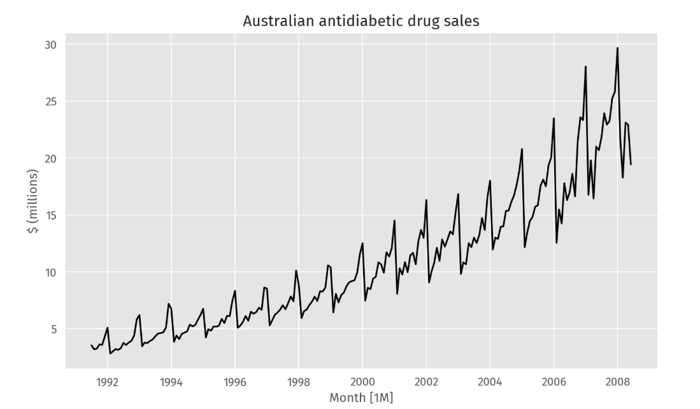
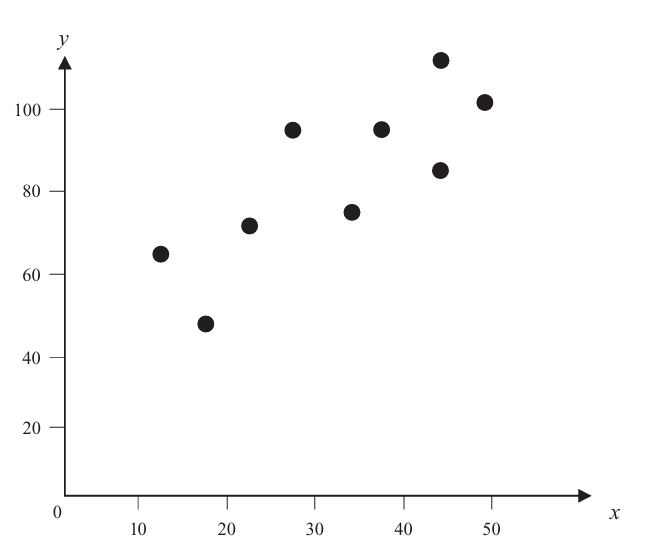
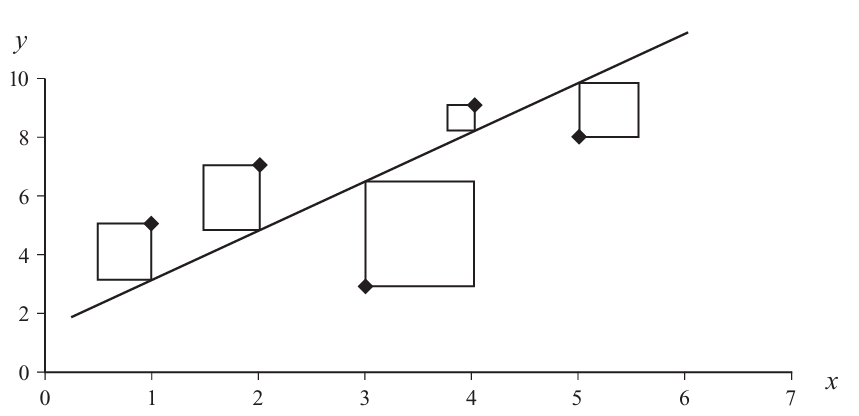
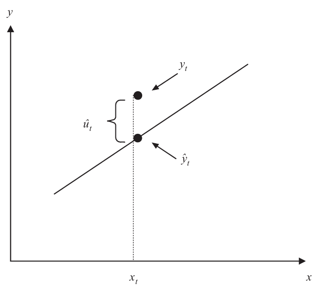

# ԳԼՈՒԽ 2․ ՖՈՆԴԱՅԻՆ ՇՈՒԿԱՅԻ ՑՈՒՑԱՆԻՇՆԵՐԻ ԿԱՆԽԱՏԵՍՄԱՆ ՄՈԴԵԼՆԵՐԸ ԵՎ ՀԵՏԱԶՈՏՈՒԹՅԱՆ ՄԵԹՈԴԱԲԱՆՈՒԹՅՈՒՆԸ

## 2.1 Ժամանակային շարքերի հիմնական հասկացությունները

Այն ամենը, ինչը հաջորդաբար դիտարկվում է ժամանակի ընթացքում, ժամանակային շարք է: Ժամանակային շարքը բաղկացած է թվային դիտարկումների հաջորդականությունից, ինչպես նաև այդ թվերի գրանցման ժամանակի մասին տեղեկատվությունից:

Ժամանակային շարքերը նկարագրելիս հաճախ օգտագործում ենք այնպիսի եզրույթներ, ինչպիսիք են «միտումը», «սեզոնայնությունը» և «ցիկլը»։

* **Միտում (Trend):** Միտում գոյություն ունի, երբ տվյալներում առկա է երկարաժամկետ աճ կամ նվազում։ Այն պարտադիր չէ, որ լինի գծային։ Երբեմն միտումը բնութագրվում է որպես «ուղղությունը փոխող», երբ այն կարող է աճող միտումից անցնել նվազող միտումի։ Նկար 1-ում պատկերված հակադիաբետիկ դեղամիջոցների վաճառքի տվյալներում առկա է միտում։
* **Սեզոնայնություն (Seasonality):** Սեզոնային օրինաչափությունն առաջանում է, երբ ժամանակային շարքի վրա ազդում են սեզոնային գործոններ, ինչպիսին են տարվա եղանակը, շաբաթվա օրը կամ օրվա ժամը։ Սեզոնայնությունն միշտ ունի ֆիքսված և հայտնի պարբերություն։ Հակադիաբետիկ դեղամիջոցների ամսական վաճառքը (Նկար 1) ցույց է տալիս սեզոնայնություն, որը մասամբ պայմանավորված է օրացուցային տարվա վերջում դեղերի արժեքի փոփոխությամբ։ Նկատենք, որ մեկ շարքը կարող է ունենալ մեկից ավելի սեզոնային օրինաչափություն։
* **Ցիկլ (Cycle):** Ցիկլն առաջանում է, երբ տվյալներում դրսևորվում են աճեր և անկումներ, որոնք չունեն ֆիքսված հաճախականություն։ Այս տատանումները սովորաբար պայմանավորված են տնտեսական պայմաններով և հաճախ կապված են «բիզնես ցիկլի» հետ, և տևողությունը սովորաբար առնվազն 2 տարի է։

**Նկար 1**  

Հեշտ է շփոթել ցիկլիկ վարքագիծը սեզոնային վարքագծի հետ, սակայն դրանք իրականում բավականին տարբեր են։ Եթե տատանումները չունեն ֆիքսված հաճախականություն, ապա դրանք ցիկլիկ են. եթե հաճախականությունն անփոփոխ է և կապված է օրացույցի որևէ առանձնահատկության հետ, ապա օրինաչափությունը սեզոնային է։ Ընդհանուր առմամբ, ցիկլերի միջին տևողությունն ավելի երկար է, քան սեզոնային օրինաչափության տևողությունը։

Բազմաթիվ ժամանակային շարքեր ներառում են միտում, ցիկլեր և սեզոնայնություն։ Կանխատեսման մեթոդ ընտրելիս անհրաժեշտ է նախ բացահայտել տվյալների մեջ առկա օրինաչափությունները, այնուհետև ընտրել այնպիսի մեթոդ, որը կարող է պատշաճ կերպով արտացոլել այդ օրինաչափությունները։

Ժամանակային շարքի հետաձգված արժեքները (lagged values) նույն շարքի նախորդ պահերի դիտարկումներն են։ Օրինակ՝ ամսական տվյալների դեպքում նախորդ ամսվա արժեքն է, իսկ անցյալ տարվա նույն ամսվա արժեքը՝ համապատասխան լեգով։ Այսպիսի արժեքները օգտագործվում են ինչպես ավտոկոռելիացիան հաշվարկելիս, այնպես էլ ավտոռեգրեսիոն մոդելներում որպես կանխատեսիչներ։

Ճիշտ այնպես, ինչպես կոռելիացիան չափում է երկու փոփոխականների միջև գծային կապի աստիճանը, ավտոկոռելիացիան չափում է ժամանակային շարքի հետաձգված արժեքների միջև գծային կապը։

Գոյություն ունեն մի քանի ավտոկոռելիացիոն գործակիցներ, որոնք համապատասխանում են հետաձգման գրաֆիկի (lag plot) յուրաքանչյուր վահանակին։ Օրինակ՝ $r_1$-ը չափում է կապը $y_t$-ի և $y_{t-1}$-ի միջև, $r_2$-ը չափում է կապը $y_t$-ի և $y_{t-2}$-ի միջև և այսպես շարունակ։

$r_k$-ի արժեքը կարող է գրվել հետևյալ կերպ.

$$r_k = \frac{\sum_{t=k+1}^T (y_t - \bar{y})(y_{t-k} - \bar{y})}{\sum_{t=1}^T (y_t - \bar{y})^2}$$

որտեղ $T$-ն ժամանակային շարքի երկարությունն է։ Ավտոկոռելիացիոն գործակիցները միասին կազմում են ավտոկոռելիացիոն ֆունկցիան (Autocorrelation Function - ACF)։

Երբ տվյալներն ունեն միտում, փոքր հետաձգումների ավտոկոռելիացիաները հակված են լինել մեծ և դրական, քանի որ ժամանակի մեջ մոտ գտնվող դիտարկումները մոտ են նաև իրենց արժեքներով։ Հետևաբար, միտում ունեցող ժամանակային շարքի ավտոկոռելիացիոն ֆունկցիան հակված է ունենալ դրական արժեքներ, որոնք դանդաղորեն նվազում են հետաձգումների մեծացմանը զուգընթաց։ Երբ տվյալները սեզոնային են, սեզոնային հետաձգումների ավտոկոռելիացիաներն ավելի մեծ կլինեն, քան մյուս հետաձգումներինը։

Այն ժամանակային շարքերը, որոնք ավտոկոռելիացիա չեն ցուցադրում, կոչվում են **սպիտակ աղմուկ**: Սպիտակ աղմուկի շարքերի համար յուրաքանչյուր ինքնակոռելիացիա մոտ է զրոյի, բայց ճշգրտորեն հավասար չէ զրոյի, քանի որ առկա է որոշակի պատահական տատանողականություն:

**Ստացիոնար** է այն ժամանակային շարքը, որի վիճակագրական հատկությունները կախված չեն այն պահից, երբ շարքը դիտարկվում է։ Հետևաբար, միտումներ կամ սեզոնայնություն ունեցող ժամանակային շարքերը ստացիոնար չեն․ միտումն ու սեզոնայնությունն իրենց ազդեցությունն են ունենում ժամանակային շարքի արժեքի վրա տարբեր ժամանակահատվածներում: Մաթեմատիկորեն սա նշանակում է, որ ժամանակի ընթացքում ժամանակային շարքի դիսպերսիան, միջինը և վիճակագրական հատկությունները չեն փոխվում։ Մյուս կողմից, սպիտակ աղմուկի շարքը ստացիոնար է։

Ցիկլային վարքագիծ ունեցող ժամանակային շարքը (առանց միտումի կամ սեզոնայնության) ստացիոնար է: Սա պայմանավորված է նրանով, որ ցիկլերը ֆիքսված երկարություն չունեն, ուստի նախքան շարքը դիտարկելը չենք կարող վստահ լինել, թե որտեղ կլինեն ցիկլերի գագաթներն ու հատակները:

Ընդհանուր առմամբ, ստացիոնար ժամանակային շարքում երկարաժամկետ հորիզոնում չկան կանխատեսելի օրինաչափություններ: 

Ոչ ստացիոնար ժամանակային շարքը ստացիոնար դարձնելու միջոցներից մեկը հաջորդական դիտարկումների միջև տարբերությունները հաշվարկելն է՝ **տարբերակումը**։ Սա կայունացնում է ժամանակային շարքի միջինը, իսկ այնպիսի ձևափոխությունները, ինչպիսին լոգարիթմն է, կայունացնում են ժամանակային շարքի դիսպերսիան: 

**Պատահական քայլքի մոդել (Random walk model):** Տարբերությունների շարքը բնօրինակ շարքի հաջորդական դիտարկումների միջև եղած փոփոխությունն է և կարող է գրվել հետևյալ կերպ.

$$y'_t = y_t - y_{t-1}$$

Այն ունենալու է միայն $T-1$ արժեք, որտեղ $T$-ն բնօրինակ շարքի անդամների քանակն է, քանի որ առաջին դիտարկման համար հնարավոր չէ հաշվարկել տարբերությունը:

Երբ տարբերությունների շարքը սպիտակ աղմուկ է, բնօրինակ շարքի մոդելը կարող է գրվել հետևյալ կերպ.

$$y'_t = \varepsilon_t$$

որտեղ $\varepsilon_t$-ն նշանակում է սպիտակ աղմուկ: Սա վերադասավորելով՝ ստանում ենք «պատահական քայլքի» մոդելը․

$$y_t = y_{t-1} + \varepsilon_t$$

Պատահական քայլքի մոդելները լայնորեն կիրառվում են ոչ ստացիոնար տվյալների, մասնավորապես՝ ֆինանսական և տնտեսական տվյալների համար: Պատահական քայլքերին սովորաբար բնորոշ են վեր կամ վար ուղղված ակնհայտ միտումների երկար ժամանակահատվածներ ուղղության հանկարծակի և անկանխատեսելի փոփոխություններ:

**Երկրորդ կարգի տարբերակում (Second-order differencing):** Երբեմն տարբերակված տվյալները ստացիոնար չեն թվում, և անհրաժեշտություն է առաջանում տվյալները տարբերակել երկրորդ անգամ՝ ստացիոնար շարք ստանալու համար.

$$y''_t = y'_t - y'_{t-1} = (y_t - y_{t-1}) - (y_{t-1} - y_{t-2}) = y_t - 2y_{t-1} + y_{t-2}$$

Այս դեպքում շարքն ունենալու է $T-2$ արժեք: Այնուհետև կմոդելավորենք բնօրինակ տվյալների «փոփոխությունների փոփոխությունը»: Գործնականում գրեթե երբեք անհրաժեշտություն չի լինում անցնելու երկրորդ կարգի տարբերություններից այն կողմ:

**Սեզոնային տարբերակում (Seasonal differencing):** Սեզոնային տարբերակումը տվյալ դիտարկման և նույն սեզոնի նախորդ դիտարկման միջև եղած տարբերությունն է: Այն գրվում է հետևյալ կերպ՝

$$y'_t = y_t - y_{t-m}$$

որտեղ $m$-ը սեզոնների քանակն է:

Եթե սեզոնայնորեն տարբերակված տվյալները սպիտակ աղմուկ են թվում, ապա բնօրինակ տվյալների համար համապատասխան մոդելն է՝

$$y_t = y_{t-m} + \varepsilon_t$$

Այս մոդելից ստացվող կանխատեսումները հավասար են համապատասխան սեզոնի վերջին դիտարկմանը: 

Եթե $y'_t$-ն նշանակում է սեզոնայնորեն տարբերակված շարք, ապա կրկնակի տարբերակված շարքը հետևյալն է՝

$$y''_t = y'_t - y'_{t-1} = (y_t - y_{t-m}) - (y_{t-1} - y_{t-1-m})$$

Երբ կիրառվում են թե՛ սեզոնային, թե՛ առաջին կարգի տարբերությունները, նշանակություն չունի, թե որն է կատարվում առաջինը՝ արդյունքը նույնն է լինելու: Այնուամենայնիվ, եթե տվյալներն ունեն ուժեղ սեզոնային բնույթ, նպատակահարմար է սեզոնային տարբերակումը կատարել առաջինը, քանի որ ստացված շարքը երբեմն կլինի ստացիոնար, և առաջին կարգի լրացուցիչ տարբերակման անհրաժեշտություն չի լինի: Եթե առաջին կարգի տարբերակումը կատարվի սկզբում, սեզոնայնությունը դեռևս առկա կլինի:

Պահանջվածից ավելի շատ տարբերությունների կիրառումը կառաջացնի կեղծ դինամիկա կամ ավտոկոռելիացիաներ, որոնք իրականում գոյություն չունեն ժամանակային շարքում: 

## 2.2 Ժամանակային շարքերի կանխատեսման ARIMA մոդելը

Մինչ ARIMA մոդելին անցնելը սահմանենք ավտոռեգրեսիոն և սահող միջինների մոդելները։ 

Ավտոռեգրեսիոն մոդելում կանխատեսում ենք հետաքրքրող փոփոխականը՝ օգտագործելով այդ նույն փոփոխականի անցյալ արժեքների գծային համակցությունը: «Ավտոռեգրեսիա» տերմինը ցույց է տալիս, որ դա փոփոխականի ռեգրեսիան է ինքն իր նկատմամբ:

Այսպիսով, $p$ կարգի ավտոռեգրեսիոն մոդելը կարող է գրվել հետևյալ կերպ․

$$y_t = c + \phi_1 y_{t-1} + \phi_2 y_{t-2} + \dots + \phi_p y_{t-p} + \varepsilon_t$$

որտեղ $\varepsilon_t$-ն սպիտակ աղմուկ է, $c$-ն՝ ազատ անդամ: Սա նման է բազմաչափ ռեգրեսիայի, սակայն որպես կանխատեսիչներ հանդես են գալիս $y_t$-ի հետաձգված արժեքները։ Այն անվանում ենք $p$ կարգի ավտոռեգրեսիոն մոդել՝ $\text{AR}(p)$ մոդել:

Ռեգրեսիայում կանխատեսվող փոփոխականի անցյալ արժեքներն օգտագործելու փոխարեն, սահող միջինի մոդելն օգտագործում է անցյալի կանխատեսման սխալանքները ռեգրեսիանման մոդելում․

$$y_t = c + \varepsilon_t + \theta_1 \varepsilon_{t-1} + \theta_2 \varepsilon_{t-2} + \dots + \theta_q \varepsilon_{t-q}$$

որտեղ $\varepsilon_t$-ն սպիտակ աղմուկ է, $c$-ն՝ ազատ անդամ: Սա կոչվում է $q$ կարգի սահող միջինի մոդել՝ $\text{MA}(q)$ մոդել:

Երբ միավորում ենք տարբերակումը ավտոռեգրեսիայի և սահող միջինի մոդելի հետ, ստանում ենք ոչ սեզոնային ARIMA մոդել: ARIMA-ն AutoRegressive Integrated Moving Average (ավտոռեգրեսիոն ինտեգրված սահող միջին) հապավումն է (այս համատեքստում «ինտեգրումը» տարբերակման հակառակ գործընթացն է): Ամբողջական մոդելը կարող է գրվել հետևյալ կերպ․

$$y'_t = c + \phi_1 y'_{t-1} + \dots + \phi_p y'_{t-p} + \theta_1 \varepsilon_{t-1} + \dots + \theta_q \varepsilon_{t-q} + \varepsilon_t$$

որտեղ $y'_t$-ն տարբերակված շարքն է (այն կարող է տարբերակվել մեկից ավելի անգամ): Աջ կողմի «կանխատեսիչները» ներառում են ինչպես $y_t$-ի հետաձգված արժեքները, այնպես էլ հետաձգված սխալանքները: Սա անվանում ենք $\text{ARIMA}(p, d, q)$ մոդել, որտեղ՝
* $p$-ն ավտոռեգրեսիոն մասի կարգն է,
* $d$-ն կիրառված առաջին կարգի տարբերակման աստիճանն է,
* $q$-ն սահող միջինի մասի կարգն է:

Սովորաբար միայն ժամանակային գրաֆիկից հնարավոր չէ ասել, թե $p$-ի և $q$-ի ինչ արժեքներն են համապատասխան տվյալների համար: Այնուամենայնիվ, երբեմն հնարավոր է օգտագործել ACF գրաֆիկը և դրան սերտորեն առնչվող PACF գրաֆիկը՝ $p$-ի և $q$-ի համապատասխան արժեքները որոշելու համար:

ACF գրաֆիկը ցույց է տալիս ինքնակոռելիացիաները։ Այժմ, եթե $y_t$-ն և $y_{t-1}$-ը կոռելիացված են, ապա $y_{t-1}$-ը և $y_{t-2}$-ը նույնպես պետք է կոռելիացված լինեն: Այնուամենայնիվ, այս դեպքում $y_t$-ն և $y_{t-2}$-ը կարող են կոռելիացված լինել պարզապես այն պատճառով, որ երկուսն էլ կապված են $y_{t-1}$-ի հետ, այլ ոչ թե $y_{t-2}$-ում պարունակվող որևէ նոր տեղեկատվության պատճառով, որը կարող է օգտագործվել $y_t$-ն կանխատեսելու համար:

Այս խնդիրը լուծելու համար հաշվում ենք մասնակի ինքնակոռելիացիաները։ Դրանք չափում են կապը $y_t$-ի և $y_{t-k}$-ի միջև՝ վերացնելուց հետո $1, 2, 3, \dots, k-1$ հետաձգումների ազդեցությունները: Մասնակի ինքնակոռելիացիաներից յուրաքանչյուրը կարող է գնահատվել որպես ավտոռեգրեսիոն մոդելի վերջին գործակից: Մասնավորապես, $\alpha_k$-ն՝ $k$-րդ մասնակի ինքնակոռելիացիայի գործակիցը, հավասար է $\text{AR}(k)$ մոդելում $\phi_k$-ի գնահատականին: Գործնականում գոյություն ունեն $\alpha_k$-ի հաշվարկման ավելի արդյունավետ ալգորիթմներ, քան այս բոլոր ավտոռեգրեսիաների հաշվարկը, սակայն դրանք տալիս են նույն արդյունքները:

Հենց մոդելի կարգը նույնականացվում է (այսինքն՝ $p$-ի, $d$-ի և $q$-ի արժեքները), պետք է գնահատենք $c, \phi_1, \dots, \phi_p, \theta_1, \dots, \theta_q$ պարամետրերը: ARIMA մոդելի գնահատման համար օգտագործվում է առավելագույն ճշմարտանմանության գնահատումը (Maximum Likelihood Estimation - MLE): Սրանով գտնում ենք պարամետրերի այն արժեքները, որոնք առավելագույնի են հասցնում մեր դիտարկած տվյալները ստանալու հավանականությունը: ARIMA մոդելների համար MLE-ն նման է նվազագույն քառակուսիների գնահատականներին, որոնք կարող են ստացվել $\sum_{t=1}^T \varepsilon_t^2$-ը նվազագույնի հասցնելու միջոցով:

Ակայկեի տեղեկատվական չափանիշն (Akaike’s Information Criterion - AIC) օգտագործվում է ARIMA մոդելի կարգը որոշելու համար: Այն գրվում է հետևյալ կերպ․

$$\text{AIC} = -2 \log(L) + 2(p + q + k + 1)$$

որտեղ $L$-ը տվյալների նմանությունն է (likelihood), $k=1$, եթե $c \neq 0$, և $k=0$, եթե $c = 0$: Նկատեք, որ փակագծերի վերջին անդամը մոդելում առկա պարամետրերի քանակն է (ներառյալ մնացորդների դիսպերսիան՝ $\sigma^2$-ը): 

ARIMA մոդելների համար ուղղված AIC-ն (corrected AIC) կարող է գրվել հետևյալ կերպ․ 

$$\text{AIC}_c = \text{AIC} + \frac{2(p + q + k + 1)(p + q + k + 2)}{T - p - q - k - 2}$$

իսկ Բայեսյան տեղեկատվական չափանիշը (Bayesian Information Criterion - BIC) գրվում է հետևյալ կերպ․ 

$$\text{BIC} = \text{AIC} + [\log(T) - 2](p + q + k + 1)$$

Լավ մոդելները ստացվում են AIC-ն, $\text{AIC}_c$-ն կամ BIC-ն նվազագույնի հասցնելու միջոցով: 

Կարևոր է նշել, որ այս տեղեկատվական չափանիշները սովորաբար լավ ուղեցույցներ չեն հանդիսանում մոդելի տարբերակման կարգի ($d$) ընտրության համար, այլ միայն $p$-ի և $q$-ի արժեքներն ընտրելու համար: Սա պայմանավորված է նրանով, որ տարբերակումը փոխում է տվյալները, որոնց վրա հաշվարկվում է նմանությունը (likelihood), ինչի հետևանքով տարբեր տարբերակման կարգեր ունեցող մոդելների AIC արժեքները համեմատելի չեն: Հետևաբար, մեզ անհրաժեշտ է օգտագործել այլ մոտեցում $d$-ն ընտրելու համար, որից հետո կարող ենք օգտագործել $\text{AIC}_c$-ն՝ $p$-ն և $q$-ն ընտրելու նպատակով:

ARIMA մոդելի կետային կանխատեսումները կարող են հաշվարկվել հետևյալ երեք քայլերով.

1. Ընդարձակել ARIMA հավասարումը այնպես, որ $y_t$-ն լինի ձախ կողմում, իսկ մյուս բոլոր անդամները՝ աջ կողմում:
2. Վերագրել հավասարումը՝ փոխարինելով $t$-ն $T + h$-ով:
3. Հավասարման աջ կողմում ապագա դիտարկումները փոխարինել դրանց կանխատեսումներով, ապագա սխալանքները՝ զրոյով, իսկ անցյալի սխալանքները՝ համապատասխան մնացորդներով:

Սկսելով $h=1$-ից՝ այս քայլերն այնուհետև կրկնվում են $h = 2, 3, \dots$ համար, մինչև բոլոր կանխատեսումները հաշվարկվեն:

Առաջին կանխատեսման միջակայքը հեշտ է հաշվարկել: Եթե $\hat{\sigma}$-ն մնացորդների ստանդարտ շեղումն է, ապա 95% կանխատեսման միջակայքը տրվում է հետևյալ կերպ՝ $\hat{y}_{T+1|T} \pm 1.96\hat{\sigma}$: Այս արդյունքը ճիշտ է բոլոր ARIMA մոդելների համար՝ անկախ դրանց պարամետրերից և կարգերից:

$\text{ARIMA}(0,0,q)$ մոդելների բազմաքայլ կանխատեսման միջակայքերը համեմատաբար հեշտ են հաշվարկվում: Մենք կարող ենք գրել մոդելը որպես․

$$y_t = \varepsilon_t + \sum_{i=1}^q \theta_i \varepsilon_{t-i}$$

Այնուհետև գնահատված կանխատեսման դիսպերսիան կարող է գրվել հետևյալ կերպ․

$$\hat{\sigma}_h^2 = \hat{\sigma}^2 \left[ 1 + \sum_{i=1}^{h-1} \hat{\theta}_i^2 \right], \quad \text{երբ } h = 2, 3, \dots$$

որտեղ $`\hat{\theta}_i = 0`$, երբ $`i > q`$, և 95% կանխատեսման միջակայքը տրվում է $`\hat{y}_{T+h|T} \pm 1.96\hat{\sigma}_h`$ բանաձևով։

ARIMA մոդելների կանխատեսման միջակայքերը հիմնված են այն ենթադրությունների վրա, որ մնացորդներն կոռելիացված չեն և նորմալ բաշխված: Եթե այս ենթադրություններից որևէ մեկը չի կատարվում, ապա կանխատեսման միջակայքերը կարող են սխալ լինել:

Ընդհանուր առմամբ, ARIMA մոդելների կանխատեսման միջակայքերն աճում են կանխատեսման հորիզոնի մեծացմանը զուգընթաց: Ստացիոնար մոդելների դեպքում (այսինքն՝ $d = 0$ դեպքում) դրանք կհավասարակշռվեն, այնպես որ երկարաժամկետ հորիզոնների համար կանխատեսման միջակայքերը ըստ էության նույնն են լինելու: $d \ge 1$ դեպքում կանխատեսման միջակայքերը շարունակելու են աճել դեպի ապագա:

Ինչպես կանխատեսման միջակայքերի հաշվարկների մեծ մասի դեպքում, ARIMA-ի վրա հիմնված միջակայքերը հակված են լինել չափազանց նեղ: Սա տեղի է ունենում այն պատճառով, որ հաշվի է առնվել միայն սխալանքների փոփոխականությունը: Գոյություն ունի նաև փոփոխականություն պարամետրերի գնահատականներում և մոդելի կարգում, որը ներառված չէ հաշվարկի մեջ: Բացի այդ, հաշվարկը ենթադրում է, որ մոդելավորված պատմական օրինաչափությունները շարունակվելու են մինչև կանխատեսման ժամանակաշրջան:

## 2.3 Ժամանակային շարքերի կանխատեսման Prophet մոդելը

Ժամանակային շարքերը հաճախ ունենում են սեզոնային օրինաչափություններ, ընդ որում՝ որքան բարձր է տվյալների հաճախականությունը, այնքան սեզոնայնությունը կարող է լինել ավելի բարդ։ Օրինակ՝ օրական տվյալները կարող են միաժամանակ ունենալ և՛ շաբաթական, և՛ տարեկան օրինաչափություն, իսկ ժամային տվյալները՝ նաև օրական։ Պարտադիր չէ, որ մոդելներում ներառված լինեն բոլոր հնարավոր սեզոնային պարբերությունները, այլ միայն նրանք, որոնք հավանաբար առկա են տվյալներում։ Օրինակ՝ եթե ունենք ընդամենը 180 օրվա տվյալներ, կարող ենք անտեսել տարեկան սեզոնայնությունը։

Prophet-ը Facebook-ի կողմից ներկայացված մոդել է (Taylor & Letham, 2018)։ Այն սկզբնապես նախատեսված էր շաբաթական և տարեկան սեզոնայնությամբ, ինչպես նաև տոների ազդեցությամբ օրական տվյալների կանխատեսման համար, իսկ հետագայում ընդլայնվել է սեզոնայնության այլ տեսակների համար։ Այն լավագույնս աշխատում է ուժեղ սեզոնայնություն ունեցող և պատմական տվյալների մի քանի սեզոն ընդգրկող շարքերի հետ։

Prophet-ը ժամանակային շարքի վերլուծելի (decomposable) մոդել է, որը բաղկացած է երեք հիմնական բաղադրիչից՝ միտումից, սեզոնայնությունից և տոներից.

$$
y(t) = g(t) + s(t) + h(t) + \varepsilon_t
$$

որտեղ

- $g(t)$-ն միտումի ֆունկցիան է, որը նկարագրում է շարքի արժեքների ոչ պարբերական, երկարաժամկետ փոփոխությունները,
- $s(t)$-ն սեզոնային բաղադրիչն է, որը նկարագրում է պարբերական փոփոխությունները (օրինակ՝ շաբաթական և տարեկան),
- $h(t)$-ն տոների ազդեցությունն է, որոնք տեղի են ունենում անկանոն գրաֆիկով,
- $\varepsilon_t$-ն սխալի անդամն է, որը ներկայացնում է մոդելի կողմից հաշվի չառնվող յուրահատուկ փոփոխությունները. ենթադրվում է, որ այն բաշխված է նորմալ օրենքով։

Այս մոդելի առավելությունն այն է, որ հեշտությամբ տրոհվում է բաղադրիչների, և անհրաժեշտության դեպքում կարելի է ավելացնել նորերը։ Բացի այդ, կանխատեսման խնդիրը դիտարկվում է որպես կորի մոտարկման խնդիր, ի տարբերություն այն մոդելների, որոնք բացահայտորեն հաշվի են առնում տվյալների ժամանակային կախվածության կառուցվածքը։

Prophet-ում ներդրված է միտումի երկու մոդել՝ հագեցող աճի մոդել և կտոր առ կտոր գծային մոդել։

Հագեցող աճը սովորաբար մոդելավորվում է լոգիստիկ աճի մոդելի միջոցով, որն իր ամենապարզ ձևով ունի հետևյալ տեսքը.

$$
g(t) = \frac{C}{1 + \exp\left(-k(t - m)\right)}
$$

որտեղ

- $C$-ն կարողունակությունն է, այսինքն՝ այն առավելագույն արժեքը, որին կարող է հասնել շարքը,
- $k$-ն աճի տեմպն է,
- $m$-ը շեղման պարամետրն է, որը որոշում է կորի դիրքը ժամանակի առանցքի վրա։

Իրական տվյալների համար այս հավասարումը բավարար չէ երկու պատճառով. կարողունակությունը հաստատուն չէ, ուստի $C$-ն փոխարինվում է ժամանակից կախված $C(t)$ ֆունկցիայով։ Աճի տեմպը նույնպես կարող է փոխվել տարբեր գործոնների ազդեցությամբ։

Միտումի փոփոխություններն աճի մոդելում ներառելու համար սահմանվում են փոփոխման կետեր (changepoints), որտեղ աճի տեմպին թույլատրվում է փոխվել։ Ենթադրենք՝ կան $S$ փոփոխման կետեր $s_j$ ($j = 1, \ldots, S$) ժամանակներում։ Սահմանվում է տեմպի ճշգրտումների վեկտորը՝ $\delta \in \mathbb{R}^S$, որտեղ $\delta_j$-ն $s_j$ պահին տեմպի փոփոխությունն է։ Ցանկացած $t$ պահին տեմպը հավասար է բազային $k$ տեմպին՝ գումարած մինչ այդ պահը տեղի ունեցած բոլոր ճշգրտումները՝

$$
k + \sum_{j:\, t > s_j} \delta_j
$$

Սա ավելի մաքուր կերպով ներկայացվում է $a(t) \in \lbrace 0, 1 \rbrace^S$ վեկտորի սահմանմամբ այնպես, որ

$$
a_j(t) =
\begin{cases}
1, & \text{եթե } t \ge s_j, \\
0, & \text{հակառակ դեպքում։}
\end{cases}
$$

Այդ դեպքում $t$ ժամանակում տեմպը հավասար է $k + a(t)^\top \delta$։ Երբ տեմպը փոխվում է, շեղման $m$ պարամետրը նույնպես պետք է ճշգրտվի, որպեսզի կորի հատվածները միանան առանց ընդհատումների։ $j$-րդ փոփոխման կետում ճշգրտումը հաշվարկվում է հետևյալ կերպ.

$$
\gamma_j = \left(s_j - m - \sum_{l < j} \gamma_l\right)\left(1 - \frac{k + \sum_{l < j} \delta_l}{k + \sum_{l \le j} \delta_l}\right)
$$

Այսպիսով, կտոր առ կտոր լոգիստիկ աճի մոդելը ստանում է հետևյալ տեսքը.

$$
g(t) = \frac{C(t)}{1 + \exp\left(-\left(k + a(t)^\top \delta\right)\left(t - \left(m + a(t)^\top \gamma\right)\right)\right)}
$$

որտեղ $k + a(t)^\top \delta$-ն $t$ պահի ճշգրտված տեմպն է, իսկ $m + a(t)^\top \gamma$-ն՝ ճշգրտված շեղումը։

Փոփոխման կետերը կարող են սահմանվել վերլուծաբանի կողմից՝ հաշվի առնելով աճը փոփոխող իրադարձությունները, կամ ավտոմատ կերպով։ Ավտոմատ ընտրության դեպքում սահմանվում է մեծ թվով թեկնածու կետեր, և $\delta$-ի վրա դրվում է նոսր ապրիոր բաշխում (sparse prior)՝ $\delta_j \sim \mathrm{Laplace}(0, \tau)$, որտեղ $\tau$ պարամետրը վերահսկում է մոդելի ճկունությունը՝ տեմպը փոխելու հարցում։ Որքան $\tau$-ն փոքր է, այնքան ավելի քիչ ճշգրտումներ են կատարվում, և երբ $\tau$-ն ձգտում է 0-ի, մոդելը վերածվում է սովորական (ոչ կտոր առ կտոր) լոգիստիկ կամ գծային աճի։

Ժամանակային շարքերը հաճախ ունենում են մի քանի պարբերությամբ սեզոնայնություն։ Օրինակ՝ 5-օրյա աշխատանքային շաբաթը կարող է առաջացնել շաբաթական կրկնվող ազդեցություններ, իսկ արձակուրդները՝ տարեկան։

Պարբերական ազդեցությունները ճկուն կերպով մոդելավորելու համար օգտագործվում է Ֆուրյեի շարքը։ Դիցուք $P$-ն այն կանոնավոր պարբերությունն է, որն ակնկալվում է շարքում (օրինակ՝ $P = 365.25$ տարեկան և $P = 7$ շաբաթական սեզոնայնության համար, երբ ժամանակը չափվում է օրերով)։ Այդ դեպքում սեզոնային ազդեցությունը մոտարկվում է հետևյալ կերպ.

$$
s(t) = \sum_{n=1}^{N} \left( a_n \cos\left(\frac{2\pi n t}{P}\right) + b_n \sin\left(\frac{2\pi n t}{P}\right) \right)
$$

որը ստանդարտ Ֆուրյեի շարք է։ Այստեղ $N$-ը Ֆուրյեի շարքի անդամների թիվն է, իսկ $a_n$ և $b_n$-ը գնահատվող գործակիցներն են։ Ընդհանուր առմամբ պետք է գնահատել $2N$ պարամետր՝ $\beta = [a_1, b_1, \ldots, a_N, b_N]^\top$։ Դրա համար յուրաքանչյուր $t$ պահի համար կառուցվում է սեզոնայնության վեկտոր, օրինակ՝ տարեկան սեզոնայնության և $N = 10$-ի դեպքում.

$$
X(t) = \left[\cos\left(\frac{2\pi (1) t}{365.25}\right), \ldots, \sin\left(\frac{2\pi (10) t}{365.25}\right)\right]
$$

Այդ դեպքում սեզոնային բաղադրիչը կլինի.

$$
s(t) = X(t)\beta
$$

որտեղ $\beta$ պարամետրերի վրա դրվում է հարթեցնող նորմալ ապրիոր բաշխում՝ $\beta \sim \mathrm{Normal}(0, \sigma^2)$։

$N$-ը գործում է որպես ցածր հաճախականությունների զտիչ. այն մեծացնելիս մոդելը կարողանում է հարմարվել ավելի արագ փոփոխվող օրինաչափություններին, սակայն մեծանում է գերուսուցման ռիսկը։ Փորձը ցույց է տվել, որ տարեկան սեզոնայնության համար $N = 10$-ը, իսկ շաբաթականի համար $N = 3$-ը լավ են աշխատում խնդիրների մեծ մասի համար։ Այդ պարամետրերի ընտրությունը կարելի է ավտոմատացնել, օրինակ՝ AIC չափանիշի միջոցով։

Տոներն ու իրադարձությունները մեծ, որոշ չափով կանխատեսելի ցնցումներ են առաջացնում ժամանակային շարքերում և հաճախ չեն հետևում պարբերական օրինաչափության, ուստի դրանց ազդեցությունները լավ չեն մոդելավորվում (օրինակ՝ Գոհաբանության օրը նշվում է նոյեմբերի չորրորդ հինգշաբթի, իսկ որոշ երկրների խոշոր տոները հետևում են լուսնային օրացույցին)։ Քանի որ կոնկրետ տոնի ազդեցությունը տարեցտարի հաճախ նման է լինում, կարևոր է այն ներառել մոդելում։

Վերլուծաբանը տրամադրում է անցյալ և ապագա իրադարձությունների ցանկ՝ յուրաքանչյուրը եզակի անվանումով։ Գլոբալ տոներից բացի կարող են ավելացվել նաև կոնկրետ երկրին հատուկ տոներ, և կանխատեսման համար օգտագործվում է այս երկու բազմությունների միավորումը։

Տոների այս ցանկի ներառումը մոդելի մեջ պարզեցվում է՝ ենթադրելով, որ տոների ազդեցություններն անկախ են միմյանցից։ Դիցուք յուրաքանչյուր $i$ տոնի համար $D_i$-ն այդ տոնի անցյալ և ապագա ամսաթվերի բազմությունն է։ Ներմուծվում է ինդիկատորային ֆունկցիա, որը ցույց է տալիս՝ արդյոք $t$ ժամանակը համընկնում է $i$ տոնի հետ, և յուրաքանչյուր տոնին վերագրվում է $\kappa_i$ պարամետրը, որը կանխատեսման մեջ համապատասխան փոփոխությունն է։ Սա արվում է սեզոնայնությանը նման ձևով՝ կառուցելով ռեգրեսորների մատրից.

$$
Z(t) = \left[\mathbf{1}(t \in D_1), \ldots, \mathbf{1}(t \in D_L)\right]
$$

և վերցնելով

$$
h(t) = Z(t)\kappa
$$

որտեղ $L$-ը տոների թիվն է, $\mathbf{1}(\cdot)$-ը ինդիկատորային ֆունկցիա է (հավասար է 1-ի, եթե $t$-ն տոնի օր է, և 0-ի՝ հակառակ դեպքում), իսկ $\kappa$-ն տոների ազդեցության գործակիցների վեկտորն է։ Սեզոնայնության նման՝ $\kappa$-ի վրա դրվում է նորմալ ապրիոր բաշխում՝ $\kappa \sim \mathrm{Normal}(0, \nu^2)$։ Երբ կարևոր է հաշվի առնել նաև տոնին հարևան օրերի ազդեցությունը (օրինակ՝ Գոհաբանության օրվա հանգստյան օրերը), տոնը շրջապատող պատուհանի յուրաքանչյուր օր դիտարկվում է որպես առանձին տոն։

## 2.4 Մեքենայական ուսուցման ռեգրեսիոն մոդելները

Ռեգրեսիոն վերլուծությունը (regression analysis) ամենակարևոր գործիքներից մեկն է կանխատեսումներ անելու համար։ Ընդհանուր առմամբ, ռեգրեսիան զբաղվում է տվյալ փոփոխականի և մեկ կամ մի քանի այլ փոփոխականների միջև եղած կապի նկարագրմամբ և գնահատմամբ։ Ավելի կոնկրետ՝ այն բացատրում է մեկ փոփոխականի տատանումները՝ հիմնվելով մեկ կամ մի քանի այլ փոփոխականների տատանումների վրա։

Այն փոփոխականը, որի տատանումները ռեգրեսիան փորձում է բացատրել, կնշանակենք $y$-ով, իսկ այն փոփոխականները, որոնք օգտագործվում են այդ տատանումները բացատրելու համար՝ $x_1, x_2, \ldots, x_k$-ով։ Հետևաբար, կարելի է ասել, որ $k$ փոփոխականների ($x$-երի) տատանումները առաջացնում են փոփոխություններ մեկ այլ փոփոխականի՝ $y$-ի մեջ։

Կոռելիացիայի սահմանման համաձայն՝ երկու փոփոխականների միջև կոռելիացիան չափում է դրանց միջև գծային կապի աստիճանը։ Եթե նշվում է, որ $y$-ը և $x$-ը կոռելիացված են, նշանակում է, որ $y$-ը և $x$-ը դիտարկվում են լիովին սիմետրիկ ձևով։ Այսպիսով, չի ենթադրվում, որ $x$-ի փոփոխությունները առաջացնում են $y$-ի փոփոխություններ, կամ որ $y$-ի փոփոխությունները առաջացնում են $x$-ի փոփոխություններ։ Փոխարենը նշվում է, որ կա վկայություն երկու փոփոխականների միջև գծային կապի մասին, և որ երկուսի տատանումները միջինում փոխկապակցված են կոռելիացիայի գործակցով տրված աստիճանով։

Ռեգրեսիայում ենթադրվում է, որ $y$ փոփոխականը որոշակի առումով պատահական կամ «ստոխաստիկ» է, այսինքն՝ ունի հավանականային բաշխում։ Սակայն $x$ փոփոխականները կրկնվող ընտրանքներում համարվում են ֆիքսված («ոչ ստոխաստիկ») արժեքներ ունեցող։

**Պարզ գծային ռեգրեսիա։** Պարզության համար ենթադրենք, որ $y$-ը կախված է միայն մեկ $x$ փոփոխականից։ Նմանատիպ կապի օրինակ է, թե ինչպես են ակտիվների եկամտաբերությունները փոփոխվում՝ կախված դրանց շուկայական ռիսկի մակարդակից, կամ բաժնետոմսերի գների և դիվիդենտների միջև երկարաժամկետ կապի չափումը և այլն։ Ենթադրենք, որ $y$ և $x$ երկու փոփոխականների միջև պետք է լինի կապ, և ֆինանսական տեսությունը հուշում է, որ $x$-ի աճը կհանգեցնի $y$-ի աճին։ Փոփոխականների միջև կապի առկայությունը ստուգելու առաջին քայլը կլինի դրանց ցրման դիագրամի (scatter plot) կառուցումը, որի օրինակը տրված է Նկ․ 2-ում։

*Նկար 2. $`x`$ և $`y`$ փոփոխականների ցրման դիագրամի օրինակ*  

Եթե այդ գրաֆիկից երևում է, որ $x$-ի և $y$-ի միջև կա մոտավոր դրական գծային կապ, նշանակում է, որ $x$-ի աճը սովորաբար ուղեկցվում է $y$-ի աճով, և որ դրանց միջև կապը կարելի է մոտավորապես նկարագրել ուղիղ գծով։

Հնարավոր կլիներ գրաֆիկի վրա ձեռքով գծել մի ուղիղ, որը կարծես համապատասխանում է տվյալներին, և աչքաչափով գծված ուղղի ազատ անդամն ու թեքությունը չափել գրաֆիկից։ Սակայն գործնականում նման մեթոդը կլինի աշխատատար և ոչ ճշգրիտ։ Հետևաբար, պետք է որոշել, թե ինչպես կարելի է այս կապը նկարագրել մի հավասարմամբ, որը կարող է գնահատվել սահմանված ընթացակարգի միջոցով։ Կարելի է օգտագործել ուղիղ գծի ընդհանուր հավասարումը՝ տվյալներին լավագույնս «համապատասխանող» ուղիղը ստանալու համար.

$$y = \alpha + \beta x :$$

Այդ դեպքում պետք է գտնել $\alpha$ և $\beta$ պարամետրերի այնպիսի արժեքներ, որոնք ուղիղը կտեղադրեն հնարավորինս մոտ բոլոր տվյալների կետերին միասին վերցրած։

Սակայն այս հավասարումը ճշգրիտ (դետերմինիստական) է։ Ենթադրելով, որ այս հավասարումը տեղին է, եթե $\alpha$-ի և $\beta$-ի արժեքները հաշվարկված լինեին, ապա $x$-ի տրված արժեքի դեպքում հնարավոր կլիներ լիակատար վստահությամբ որոշել, թե ինչպիսին կլինի $y$-ի արժեքը։ Ակնհայտ է, որ այս մոդելը իրատեսական չէ։ Մոդելն ավելի իրատեսական դարձնելու համար հավասարմանն ավելացվում է պատահական շեղման անդամ (random disturbance term), որը նշանակվում է $u$-ով.

$$y_t = \alpha + \beta x_t + u_t ,$$

որտեղ $t = 1, 2, 3, \ldots$ ինդեքսը ցույց է տալիս դիտարկման համարը։ Շեղման անդամը կարող է արտացոլել մի շարք գործոններ (օրինակ՝ մոդելում չներառված փոփոխականների ազդեցությունը կամ չափման սխալները)։

$\alpha$-ն և $\beta$-ն ընտրվում են այնպես, որ տվյալների կետերից մինչև կառուցված ուղիղը եղած (ուղղահայաց) հեռավորությունները նվազագույնի հասցվեն (որպեսզի ուղիղը հնարավորինս սերտորեն համապատասխանի տվյալներին)։ Այսպիսով, պարամետրերն ընտրվում են տվյալների կետերից մինչև կառուցված ուղիղը եղած ուղղահայաց հեռավորությունները նվազագույնի հասցնելու համար։

Տվյալներին ուղիղ գիծ համապատասխանեցնելու ամենատարածված մեթոդը հայտնի է որպես փոքրագույն քառակուսիների սովորական մեթոդ (Ordinary Least Squares - OLS)։

Այժմ, պարզության համար ենթադրենք, որ տվյալների ընտրանքը պարունակում է ընդամենը հինգ դիտարկում։ OLS մեթոդը ենթադրում է վերցնել յուրաքանչյուր կետից մինչև ուղիղը եղած ուղղահայաց հեռավորությունը, բարձրացնել այն քառակուսի և այնուհետև նվազագույնի հասցնել քառակուսիների մակերեսների ընդհանուր գումարը (այստեղից էլ՝ «փոքրագույն քառակուսիներ» անվանումը)։ Սա կարելի է դիտարկել որպես կետերից մինչև ուղիղը գծված քառակուսիների մակերեսների գումարի նվազագույնի հասցնելուն համարժեք գործընթաց, որը ցուցադրված է Նկ․ 3-ում։

*Նկար 3. OLS մեթոդը. Տվյալներին ուղիղ գծի համապատասխանեցում մնացորդների քառակուսիների գումարը նվազագույնի հասցնելու միջոցով*  

Դիցուք $y_t$-ն $t$ դիտարկման փաստացի տվյալների կետն է, իսկ $\hat{y}_t$-ն՝ ռեգրեսիոն ուղղով ստացված հաշվարկային (կանխատեսված) արժեքը, $u_t$-ն մնացորդն (residual) է, որը տվյալ կետի համար $y$-ի փաստացի արժեքի և մոդելի կողմից ստացված արժեքի միջև տարբերությունն է, այսինքն՝ $u_t = y_t - \hat{y}_t$ (Նկ․ 4)։

Այն, ինչ արվում է, $u_t^2$-ների գումարը նվազագույնի հասցնելն է։ Պատճառը, որ նվազագույնի է հասցվում քառակուսիացված հեռավորությունների գումարը, այլ ոչ թե, օրինակ, $u_t$-երի գումարը, այն է, որ վերջին դեպքում որոշ կետեր գտնվում են ուղղից վերև, իսկ մյուսները՝ ուղղից ներքև։ Այդ դեպքում, երբ կազմվում է $u_t$-երի գումարը, ուղղից վերև գտնվող կետերը ընդունում են դրական արժեքներ, իսկ ներքև գտնվողները՝ բացասական։ Այսպիսով, այդ հեռավորությունները մեծ մասամբ չեզոքացնում են միմյանց, ինչը նշանակում է, որ տվյալներին կարելի է գործնականում համապատասխանեցնել ցանկացած ուղիղ, քանի դեռ ուղղից վերև գտնվող կետերի հեռավորությունների գումարը և ուղղից ներքև գտնվող կետերի հեռավորությունների գումարը հավասար են։ Այդ դեպքում գնահատված գործակիցների համար միակ լուծում գոյություն չէր ունենա։ Ցանկացած կառուցված ուղիղ, որն անցնում է դիտարկումների միջինով (այսինքն՝ $(\bar{x}, \bar{y})$ կետով), $u_t$-երի գումարը դարձնում է զրո։ Սակայն հեռավորությունների քառակուսիները վերցնելը երաշխավորում է, որ հաշվարկի մեջ մտնող բոլոր շեղումները դրական են և, հետևաբար, չեն չեզոքացնում միմյանց։

 *Նկար 4. Մեկ դիտարկման գրաֆիկը՝ լավագույն համապատասխանության ուղղի, մնացորդի և հաշվարկային (կանխատեսված) արժեքի հետ միասին*

Այսպիսով, քառակուսիացված հեռավորությունների գումարի նվազագույնի հասցնելը տրվում է հետևյալ արտահայտությունը նվազագույնի հասցնելով՝

$$\sum_{t=1}^{5} u_t^2 :$$

Այս գումարը հայտնի է որպես մնացորդների քառակուսիների գումար (residual sum of squares - RSS) կամ քառակուսիացված մնացորդների գումար։ Այն նվազագույնի հասցնելը համարժեք է $\sum_{t=1}^{5}(y_t - \hat{y}_t)^2$ արտահայտությունը նվազագույնի հասցնելուն։

$\hat{\alpha}$-ով և $\hat{\beta}$-ով նշանակենք $\alpha$-ի և $\beta$-ի այն արժեքները, որոնք ընտրվել են RSS-ը նվազագույնի հասցնելու միջոցով. այդ դեպքում կառուցված ուղղի հավասարումը տրվում է $\hat{y}_t = \hat{\alpha} + \hat{\beta}x_t$ տեսքով։ Այժմ $L$-ով նշանակենք RSS-ը, որը հայտնի է նաև որպես կորուստների ֆունկցիա (loss function)։ Վերցնենք գումարը բոլոր դիտարկումների վրայով, այսինքն՝ $t = 1$-ից մինչև $T$, որտեղ $T$-ն դիտարկումների քանակն է.

$$L = \sum_{t=1}^{T}(y_t - \hat{y}_t)^2 = \sum_{t=1}^{T}(y_t - \hat{\alpha} - \hat{\beta}x_t)^2 :$$

$L$-ը նվազագույնի է հասցվում ըստ $\hat{\alpha}$-ի և $\hat{\beta}$-ի, այսինքն $L$-ը դիֆերենցվում է ըստ $\hat{\alpha}$-ի և $\hat{\beta}$-ի՝ առաջին կարգի ածանցյալները հավասարեցնելով զրոյի։ Թեքության և ազատ անդամի գործակիցների գնահատականները տրվում են հետևյալ բանաձևերով.

$$\hat{\beta} = \frac{\sum x_t y_t - T\bar{x}\bar{y}}{\sum x_t^2 - T\bar{x}^2} ,$$

$$\hat{\alpha} = \bar{y} - \hat{\beta}\bar{x} :$$

Այս հավասարումները փաստում են, որ ունենալով միայն $x_t$ և $y_t$ դիտարկումների բազմությունները՝ միշտ հնարավոր է հաշվարկել $\hat{\alpha}$-ի և $\hat{\beta}$-ի այն արժեքները, որոնք լավագույնս համապատասխանում են տվյալների հավաքածուին։ Հարկ է նաև նշել, որ $\hat{\alpha}$-ի հավասարումից ակնհայտ է, որ ռեգրեսիոն ուղիղը կանցնի դիտարկումների միջինով, այսինքն՝ $(\bar{x}, \bar{y})$ կետը գտնվում է ռեգրեսիոն ուղղի վրա։

**Դասական գծային ռեգրեսիոն մոդելի հիմքում ընկած ենթադրությունները։** Վերևում դուրս բերված $y_t = \alpha + \beta x_t + u_t$ մոդելը՝ ստորև թվարկված ենթադրությունների հետ միասին, հայտնի է որպես դասական գծային ռեգրեսիոն մոդել (Classical Linear Regression Model - CLRM)։ Քանի որ $y_t$-ն կախված է ոչ միայն $x_t$-ից, այլ նաև $u_t$-ից, ուստի անհրաժեշտ է հստակեցնել, թե ինչպես են առաջանում $u_t$-երը։ Ստորև ներկայացված ենթադրությունների համակարգը սովորաբար արվում է $u_t$-երի՝ չդիտարկվող սխալների կամ խանգարման անդամների վերաբերյալ։

1. $E(u_t) = 0$, սխալներն ունեն զրոյական մաթեմատիկական սպասում (միջին)։
2. $\mathrm{var}(u_t) = \sigma^2 < \infty$, սխալների դիսպերսիան հաստատուն է և վերջավոր՝ $x_t$-ի բոլոր արժեքների համար (հոմոսկեդաստիկության ենթադրություն)։
3. $\mathrm{cov}(u_i, u_j) = 0$, սխալները գծայնորեն անկախ են միմյանցից (ավտոկոռելիացիայի բացակայություն)։
4. $\mathrm{cov}(u_t, x_t) = 0$, սխալի և համապատասխան $x$ փոփոխականի միջև կապ չկա։
5. $u_t \sim N(0, \sigma^2)$, $u_t$-ն բաշխված է նորմալ օրենքով։

Բերվածներից 1-ը և 4-ը ենթադրում են, որ ռեգրեսորը օրթոգոնալ է (այսինքն՝ կապված չէ) սխալի անդամին։ 4-րդ ենթադրությանը այլընտրանքային՝ մի փոքր ավելի խիստ ենթադրությունն այն է, որ $x_t$-երը ֆիքսված են կրկնվող ընտրանքներում։ Սա նշանակում է, որ $x_t$-ում ընտրանքային տատանումներ չկան, և դրա արժեքը որոշվում է մոդելից դուրս։ Հինգերորդ ենթադրությունն անհրաժեշտ է վերջավոր քանակությամբ տվյալների միջոցով գնահատված ընտրանքային պարամետրերից ($\hat{\alpha}$ և $\hat{\beta}$) գլխավոր համակցության պարամետրերի (իրական $\alpha$-ի և $\beta$-ի) վերաբերյալ վավեր եզրակացություններ անելու համար։

**Պարզ գծային մոդելի ընդհանրացումը բազմաչափ գծային ռեգրեսիայի։** Նախկինում օգտագործված $y_t = \alpha + \beta x_t + u_t,\ t = 1, 2, \ldots, T$ տեսքի մոդելը պարզ երկչափ ռեգրեսիոն մոդել է։ Այսինքն՝ կախյալ փոփոխականի փոփոխությունները բացատրվում են մեկ բացատրող՝ $x$ փոփոխականի փոփոխությունների հիման վրա։ Գործնականում կախյալ փոփոխականի վրա հաճախ ազդում է ոչ թե մեկ, այլ մի քանի անկախ փոփոխական, և ֆինանսական տեսությունը հաճախ հենց դա էլ հուշում է։ Օրինակ՝ CAPM մոդելը (կապիտալ ակտիվների գնագոյացման մոդել) կարելի է գնահատել և ստուգել պարզ գծային ռեգրեսիոն մոդելի հավասարմամբ, որտեղ բաժնետոմսի եկամտաբերության վրա ազդող միակ գործոնը շուկայի եկամտաբերությունն է։ Սակայն արբիտրաժային գնագոյացման տեսությունը (arbitrage pricing theory) ենթադրում է, որ բաժնետոմսի եկամտաբերության վրա ազդում են մի քանի գործոններ միաժամանակ, ուստի այդպիսի դեպքերում մեկ անկախ փոփոխականով հավասարումը բավարար չէ։ Այսպիսով, օրինակ՝ կարող է ենթադրվել, որ բաժնետոմսերի եկամտաբերությունները կախված են գնաճից, կարճաժամկետ և երկարաժամկետ պարտատոմսերի եկամտաբերությունների տարբերություններից, արդյունաբերական արտադրությունից և այլն։

Այս դեպքում միայն մեկ անկախ փոփոխական ունենալը բավարար չի լինի։ Իհարկե, հնարավոր կլիներ առաջարկված չորս բացատրող գործոններից յուրաքանչյուրն օգտագործել առանձին ռեգրեսիաներում, սակայն ավելի նպատակահարմար է միևնույն ռեգրեսիոն հավասարման մեջ ունենալ մեկից ավելի բացատրող փոփոխական և, հետևաբար, ուսումնասիրել բոլոր բացատրող փոփոխականների համատեղ ազդեցությունը բացատրվող փոփոխականի վրա։

Պարզ գծային ռեգրեսիոն մոդելը $k$ ռեգրեսորներով (անկախ փոփոխականներով) ընդհանրացնելով՝ բազմաչափ ռեգրեսիոն մոդելի հավասարումը ստանում է հետևյալ տեսքը.

$$y_t = \beta_1 + \beta_2 x_{2t} + \beta_3 x_{3t} + \ldots + \beta_k x_{kt} + u_t, \quad t = 1, 2, \ldots, T :$$

Այսպիսով, $x_{2t}, x_{3t}, \ldots, x_{kt}$ փոփոխականները $k-1$ բացատրող փոփոխականների բազմություն են, որոնք, ինչպես ենթադրվում է, ազդում են $y$-ի վրա, իսկ $\beta_1, \beta_2, \ldots, \beta_k$ գործակիցներն այն պարամետրերն են, որոնք քանակապես չափում են այդ բացատրող փոփոխականներից յուրաքանչյուրի ազդեցությունը $y$-ի վրա։ Բազմաչափ ռեգրեսիայի համատեքստում գործակիցների մեկնաբանությունները մի փոքր փոփոխվում են։ Յուրաքանչյուր գործակից այժմ դիտարկվում է որպես մասնակի ռեգրեսիայի գործակից (partial regression coefficient), որը մեկնաբանվում է որպես տվյալ բացատրող փոփոխականի մասնակի ազդեցությունը բացատրվող փոփոխականի վրա՝ մնացած բոլոր բացատրող փոփոխականները հաստատուն պահելու կամ դրանց ազդեցությունը բացառելու պայմաններում։

Բազմաչափ ռեգրեսիայի հավասարման մեջ բացատրող փոփոխականների ցանկը սկսվում է $x_2$-ով և ոչ թե $x_1$-ով։ Իրականում $x_1$-ն այն հաստատուն անդամն է, որը ներկայացվում է $T$ երկարությամբ միավորների սյունակով․

$$x_1 = \begin{bmatrix} 1 \cr \vdots \cr 1 \end{bmatrix} :$$

Ռեգրեսիոն հավասարման մեջ $x_1$-ը սովորաբար չի գրվում։ $\beta_1$-ը հաստատուն անդամին կցված գործակիցն է (որը միաչափ դեպքում կոչվում էր $\alpha$)։ Այս գործակիցը դեռևս կարող է անվանվել ազատ անդամ (intercept), որը կարող է մեկնաբանվել որպես այն միջին արժեքը, որը կընդունի $y$-ը, եթե բոլոր բացատրող փոփոխականներն ընդունեն զրոյական արժեք։

Բազմաչափ ռեգրեսիոն մոդելի հավասարումը կարող է արտահայտվել մատրիցային տեսքով.

$$y = X\beta + u ,$$

որտեղ՝

- $y$-ն ունի $T \times 1$ չափայնություն,
- $X$-ն ունի $T \times k$ չափայնություն,
- $\beta$-ն ունի $k \times 1$ չափայնություն,
- $u$-ն ունի $T \times 1$ չափայնություն։

Այսպիսով, $X$ մատրիցի $x_{ij}$ տարրը ներկայացնում է $i$-րդ փոփոխականի $j$-րդ ժամանակային դիտարկումը։

Բազմաչափ ռեգրեսիայի համատեքստում $\beta_1, \beta_2, \ldots, \beta_k$ պարամետրերի գնահատականները ստանալու համար RSS-ը պետք է նվազագույնի հասցվի ըստ $\beta$ վեկտորի բոլոր տարրերի։ Այժմ մնացորդները կարող են դասավորվել մեկ վեկտորի մեջ՝

$$u = \begin{bmatrix} u_1 \cr u_2 \cr \vdots \cr u_T \end{bmatrix}$$

RSS-ը դեռևս հանդիսանում է համապատասխան կորուստների ֆունկցիա և մատրիցային նշանակմամբ տրվում է հետևյալ կերպ.

$$L = u^T u = \begin{bmatrix} u_1 & u_2 & \ldots & u_T \end{bmatrix} \begin{bmatrix} u_1 \cr u_2 \cr \vdots \cr u_T \end{bmatrix} = u_1^2 + u_2^2 + \cdots + u_T^2 = \sum_{t=1}^{T} u_t^2$$

Գործակիցների գնահատականները կտրվեն հետևյալ կերպ՝

$$\hat{\beta} = \begin{bmatrix} \hat{\beta}_1 \cr \hat{\beta}_2 \cr \vdots \cr \hat{\beta}_k \end{bmatrix} = (X^T X)^{-1} X^T y$$

Հավասարման աջ մասի չափայնությունը $k \times 1$ է, որը լիովին համապատասխանում է պահանջին, քանի որ $\hat{\beta}$-ի բանաձևով պետք է գնահատվի $k$ պարամետր։